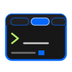

<p align="center">
  
</p>

<h1 align="center">tabby-tweaks</h1>
<h3 align="center">A drop-in config kit for Tabby — Windows Terminal-style keybindings, Firefox-style pill tabs, and tmux-style panes. No source edits, no rebuild.</h3>

<p align="center">
  <a href="https://www.youtube.com/watch?v=jU7Q0876iWU" target="_blank" rel="noopener noreferrer">
    
  </a>
</p>
<p align="center">
  <a href="https://www.youtube.com/watch?v=jU7Q0876iWU" target="_blank" rel="noopener noreferrer">
    
  </a>
</p>
<p align="center">
  <sub>UI 展示 · 分屏 / 跳转 / 调整 / 关闭 · 串口 profile 切换 — 点击图片或按钮观看</sub>
</p>

<p align="center">
  
  
  
  
  
</p>

<!--
  需要真实仓库数据的徽章：仓库已有 star/下载量后，取消对应徽章的注释即可（路径已填好）。
  当前保持注释，避免数据为 0 时显示异常。

  <a href="https://github.com/xluyang/tabby-tweaks/releases"></a>
  <a href="https://github.com/xluyang/tabby-tweaks/actions"></a>
  <a href="https://www.star-history.com/?repos=xluyang%2Ftabby-tweaks&type=date&legend=bottom-right"></a>
  Trendshift：先到 https://trendshift.io 提交仓库拿到 <repository-id>，替换下面 URL 末尾的 0。
  <a href="https://trendshift.io/repositories/0"></a>
-->

<p align="center">
  <a href="https://github.com/xluyang/tabby-tweaks"></a>
</p>

**🇨🇳 简体中文** · [English](docs/README.en.md) *(coming soon)*

<!-- 信任建设：项目刚起步，当前没有赞助商/star，占位内容会误导访客，故默认关闭。有了真实数据后取消注释即可（路径已填好）。

## Paid Sponsors

<table width="100%">
  <tr>
    <td align="center">
      <a href="mailto:xluyang@example.com"><b>Contact to sponsor</b></a><br />
      <sub>Put your product in front of embedded developers using Tabby.</sub>
    </td>
  </tr>
</table>

## Star History

<a href="https://www.star-history.com/?repos=xluyang%2Ftabby-tweaks&type=date&legend=bottom-right">
  
</a>

## Contributors

<a href="https://github.com/xluyang/tabby-tweaks/graphs/contributors">
  
</a>

-->

## About

`tabby-tweaks` 是 [Tabby](https://github.com/Eugeny/tabby) 终端的一份**开箱即用的配置套件**：把 Windows Terminal 风格的快捷键、Firefox 风格药丸标签、tmux 风格分割线，打包成一份可部署、可回滚的 `config.yaml`。

原理很简单：Tabby 把快捷键和自定义 CSS 都放在用户配置 `config.yaml` 里（`appearance.css` 会注入到页面 `<style>` 中，优先级高于主题默认）。本仓库就是这份调好效果的配置文件 + 部署/恢复脚本——**不改 Tabby 安装目录、不装编译工具、不动源码**。

无套路承诺：纯配置、不联网、不埋点。部署前自动备份，一条命令恢复出厂，随时可退。

**Good for:**
- 用惯 Windows Terminal / tmux，希望 Tabby 手感和它们一致的开发者
- 嵌入式场景里同时开 PowerShell + WSL + 多路串口，想要清爽分屏和一眼可辨的标签
- 想要"好看且不折腾"的 Tabby 外观党

**Also for machines:** 配置是可 diff 的纯文本（`config.yaml`），CSS 用主题 CSS 变量（`--theme-primary`、`--body-bg` 等）写成，换主题自动适配。想二次开发？直接改 `config.yaml` 里的 `hotkeys:` 或 `appearance.css`，跑部署脚本即可生效。

## Highlights

- ⌨️ **Windows Terminal 风格快捷键。** `Alt+Shift+=` 分屏、`Alt+方向键` 跳窗格、`Alt+Shift+方向键` 调大小——肌肉记忆零成本迁移。
- 🟣 **Firefox 风格药丸标签。** 四角全圆、主题色线圈，激活标签实色 + 同色辉光，一眼看清当前窗格。
- 🪟 **tmux 风格分割线。** 平时隐形、hover 才显主题色，焦点窗格带主题色描边，告别粗黑分割线。
- 🚫 **隐藏滚动条。** 终端视口滚动条归零但保留滚动功能，画面更干净。
- 🔌 **串口友好。** 分屏后 `Alt+Shift-S` 换 COM 口、`Alt+Shift-X` 直接关串口窗格（串口没有 shell，`exit` 关不掉它）。
- 🛡️ **安全部署。** 脚本先备份再覆盖，且检测到 Tabby 在运行就直接拒绝——杜绝"改了没生效"。
- ↩️ **一键恢复出厂。** `restore.ps1` 用原始配置覆盖，当前配置自动留底，随时反悔。
- 🧩 **兼容后续客制化。** 套件式结构，新增主题/快捷键/插件只需加文件，不用改名。

## Get started

> [!IMPORTANT]
> **先完全退出 Tabby（含托盘图标）再运行脚本。** Tabby 运行时会把内存里的配置全量写回磁盘，覆盖你刚部署的文件——这是最容易踩的坑，脚本已内置检测并会直接拒绝。

**1. 获取配置**

```powershell
git clone https://github.com/xluyang/tabby-tweaks.git
cd tabby-tweaks
```

**2. 部署**（自动备份现有配置 → 部署 `config.yaml`）

```powershell
pwsh -File .\scripts\deploy.ps1
```

**3. 启动 Tabby**，即生效。

**平台支持**

- ✅ **Windows 10 / 11** · 验证于 Tabby **1.0.237**
- ⚪ **macOS / Linux** · 快捷键/布局概念部分通用，但本配置针对 Windows 键位与串口场景调优，未做其他平台适配

**系统要求**

- Tabby **1.0.237+**（`appearance.css`、`close-pane`、`switch-profile` 等键位需此版本）
- PowerShell 5.1+（Windows 自带）或 PowerShell 7（推荐）

## What's inside

文件结构：

| 文件 | 作用 |
|---|---|
| `config.yaml` | 当前生效配置：快捷键 + 外观 CSS |
| `config.yaml.orig` | 客制化前的原始配置（恢复出厂用） |
| `scripts/deploy.ps1` | 部署（先备份 → 覆盖） |
| `scripts/restore.ps1` | 恢复出厂（先备份 → 覆盖） |
| `assets/logo.svg` | 项目 Logo |

**快捷键一览**

| 功能 | 键位 |
|---|---|
| 向右 / 向下分屏 | `Alt+Shift+=` / `Alt+Shift+-` |
| 窗格跳转 ←↑↓→ | `Alt+方向键` |
| 分屏调宽/高 | `Alt+Shift+方向键` |
| 切换当前窗格 profile | `Alt+Shift-S` |
| 关闭当前窗格 | `Alt+Shift-X` |

**外观 CSS**（注入于 `appearance.css`）：隐藏终端滚动条 · `split-tab-spanner` 改为细线 hover 显色 · `split-tab > .child.focused` 焦点描边 · `tab-header` 四角全圆 + 主题色线圈。

> [!TIP]
> **串口换 COM 口是两步：** 先分屏（`Alt+Shift+=`，新窗格默认复制当前串口），再在新窗格按 `Alt+Shift-S` 选另一个 COM 口。PowerShell / WSL 分屏后不用第二步。

> [!TIP]
> **串口关不掉？** 串口没有本地 shell，`exit` 只会把字符发给设备。用 `Alt+Shift-X` 直接关窗格（对 PowerShell / WSL / 串口都有效）。

## Customize / 二次开发

改配置只需编辑 `config.yaml` 的两个段，然后重新部署：

```yaml
hotkeys:
  split-right:
    - Alt-Shift-=      # 改成你顺手的键
appearance:
  css: |
    /* 这里写自定义 CSS，改完部署重启即可 */
```

部署/恢复脚本都支持自定义配置目录（便携版）和跳过确认：

```powershell
pwsh -File .\scripts\deploy.ps1 -ConfigDir "D:\tabby-data"
pwsh -File .\scripts\deploy.ps1 -Force
pwsh -File .\scripts\restore.ps1 -Force
```

**关键实现依据**（改坏时能查）：
- Tabby 内置插件源码在 `C:\Program Files\Tabby\resources\builtin-plugins\`（`tabby-core/src`、`tabby-terminal/src`），比在线文档精确
- 选择器：标签 `.main.content > .tab-bar > .tabs > tab-header(.active)`；分割线 `split-tab-spanner`（`.h`/`.v`/`.active`）；焦点窗格 `split-tab > .child.focused`；终端视口 `.xterm-viewport`

## How to Contribute

> [!IMPORTANT]
> 最好的贡献方式是**先部署用一用**：打开 Tabby 看看标签有没有变圆、分屏手感对不对。如果某个效果没生效，先确认 Tabby 已完全退出后重新部署，再带着 Tabby 版本、Windows 版本和你的 `config.yaml` 片段提 issue——这比直接写代码更有价值。

- 🐛 **报 bug：** 附 Tabby 版本、Windows 版本、期望效果 vs 实际效果、相关配置片段。
- 💻 **贡献配置：** 新增/改进快捷键或 CSS，PR 请说明改了 `hotkeys:` 还是 `appearance.css`，以及验证用的 Tabby 版本。
- 📝 **写文档：** 补 English 版 `docs/README.en.md`，或补一张效果截图到 `assets/preview.png`。
- 💬 **讨论：** 用 GitHub Discussions 聊新想法与兼容性。

## Licence

- 本项目采用 [MIT](LICENSE) 开源协议，可自由使用、修改、分发，包括商业场景。
- Tabby 本体是其作者的开源项目；本仓库仅提供用户配置与脚本，不包含 Tabby 源码。

## DMCA

若你认为本仓库或其发布物侵犯了你的著作权，请通过仓库 issue 提交：被侵权作品描述、疑似侵权内容链接、你的联系方式、你善意认为该使用未经授权的说明，以及声明通知内容准确且你有权代表权利人的（电子）签名声明。有效通知将被及时处理；被移除内容可提交反通知。

## Code of Conduct / Security

- **行为准则：** 友善、就事论事、尊重不同经验水平。人身攻击与骚扰不受欢迎。
- **安全政策：** 本仓库只含配置文件与 PowerShell 脚本，**不联网、不收集数据**。脚本仅在本机复制/备份 `config.yaml`，不修改系统其他位置。若发现安全问题，请私密联系维护者而非公开 issue。

---

<p align="center">
  <sub>Made for developers who wanted their Tabby to feel like home.</sub>
</p>
